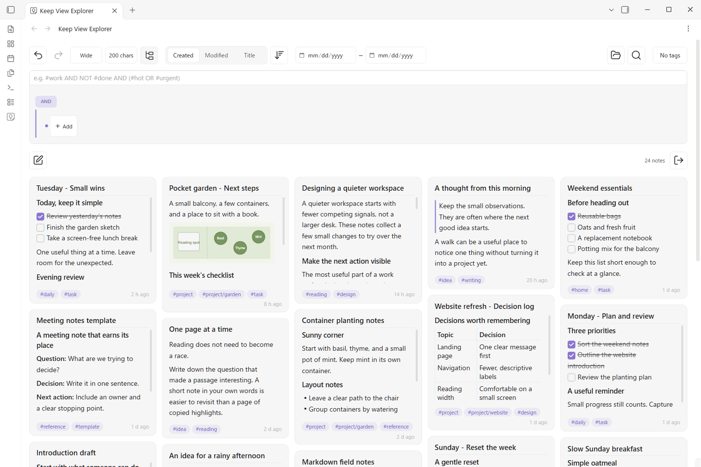

# Keep View Explorer

Markdownノートをカードで見渡す。タグと検索で絞り込んで、整理したいノートを選ぶ。



一続きの操作：24件 → projectタグ → writingを除外 → gardenを検索 → 見つかった2件を選択。

- チェックリスト・画像・リンクを含むMarkdownプレビュー。
- AND・OR・NOTを組み合わせるタグツリー。
- フォルダをたどり、タグ編集や移動をまとめて実行。

### プロジェクトのノートを探す

VaultにあるMarkdownノートから始めます。デモでは `#project` を選び、`NOT #writing` を追加し、さらに `garden` を全文検索します。同じ結果に条件を重ね、24 → 5 → 4 → 2件に絞ります。Projects/Gardenフォルダを展開し、見つかった2件を選んで一括操作の準備をします。

### 使い始める

1. コマンドパレットの **Keep View Explorer を開く**、またはリボンのアイコンで開きます。
2. タグツリーを作り、フォルダや日時を選び、全文検索を加えます。階層タグも対象になり、`#project AND NOT #writing` のような同じ条件式を直接入力することもできます。
3. PCではCtrl/Commandクリック、モバイルでは長押しでノートを選びます。選択用のツールバーでfrontmatterのタグ編集や移動を行います。本文内のタグは保持します。

ノートは通常のMarkdownファイルのままです。日本語と英語、デスクトップとモバイルに対応しています。追加のアカウント登録・広告・テレメトリーはありません。削除の扱い・元に戻せる範囲・検索キャッシュ・Markdown内の外部リソースはREADMEで説明しています。

[詳しい使い方とデータの扱い](#主な機能)

[タスク・画像・Markdownのプレビュー付きカード](media/cards-en.png) · [タグツリーで条件を組み合わせる](media/tags-en.png) · [絞り込みを維持してProjects/Gardenを展開](media/tree-en.png) · [複数選択してまとめて整理](media/selection-en.png) · [モバイルの表示](media/mobile-en.png)

[English](../README.md)

## 主な機能

- Markdown プレビュー付きのカード一覧と、フォルダのツリー表示
- タグの AND／OR／NOT、フォルダ、タグなし、日時による絞り込み
- 作成日時・更新日時・タイトルでの並び替え
- ノートの複数選択、タグ編集、移動、削除
- 検索対象のパスを JSON またはテキストで出力
- ファイル名から作成日時を取り込む移行ツール

## インストール

Obsidian 1.8.7 以降が必要です。コミュニティプラグインとしての登録は申請前です。

1. リリースの `main.js`、`manifest.json`、`styles.css` を Vault の `.obsidian/plugins/keep-view/` に配置します。ZIP の場合は中の `keep-view` フォルダを配置します。
2. Obsidian の設定でコミュニティプラグインを有効にし、Keep View Explorer を有効にします。
3. リボンの Keep View Explorer アイコン、またはコマンド **Open Keep View Explorer** で開きます。

更新時はプラグインを無効にして配布ファイルを置き換え、再び有効にします。設定を保存する `data.json` は残してください。ソースコードの `main.js` は開発用です。手動インストールにはリリースまたは `dist/keep-view/` のファイルを使用してください。

## ノートを探す

タグはドロップダウンや式で指定できます。例えば `#仕事 AND NOT #完了 AND (#重要 OR #緊急)` は、仕事タグがあり、完了しておらず、重要または緊急のノートを表示します。フォルダ・タグなし・期間指定はタグ条件と AND で組み合わせます。

「作成日時」はノートのプロパティを参照します。初期値は `created` で、設定から変更できます。設定の「日時プロパティ」は空欄にすると `created` を使います。「新規ノートの作成日時」のタイムゾーンは空欄で端末設定、「プレビュー文字数」は空欄で `50, 100, 150, 200, 400` に戻ります。

```yaml
---
created: "2026-02-09T15:46:51.388+09:00"
---
```

未設定や無効な日時は並び順の末尾になり、期間指定時には除外します。「更新日時」はファイルの更新日時を使います。期間は端末のタイムゾーンに従います。

## 全文検索

虫眼鏡で入力した文字を含むノートだけをカード一覧に表示します。タグ・フォルダ・期間・タグなしの条件で候補を絞った後、その候補だけを検索します。パス出力とツリー表示にも全文検索の結果を反映します。

ノート名と Markdown 本文全体（フロントマターを含む）が対象です。日本語の1文字や単語の途中でも一致します。空白や記号も入力どおりに検索し、英字の大文字・小文字は区別しません。表示中のプレビュー文字数は検索範囲に影響しません。

初めて検索した候補ノートについて、全文検索用の本文と更新情報を圧縮して保存します。保存先はプラグインフォルダ内の `search-cache-v1` です。次回以降や再起動後も再利用し、変更された候補だけを読み直して更新します。タグなどで対象外になったノートは、その検索では読み込みません。日本語の短い検索語も省略せず、本文で実際に一致するか確認します。

本文は最大8個のファイルに分け、文字の辞書化と圧縮で保存容量を抑えます。旧64分割のキャッシュは次の検索時に引き継ぎ、保存できた古いファイルから削除します。展開したデータの保持量も制限します。初回や変更が多い場合は時間がかかるため、検索中に進捗と案内を表示します。中断時も保存済みの部分を次回に引き継ぎます。保存データが壊れていた場合は、その部分を元のノートから作り直します。

検索途中でも、通常の並び順で位置が確定したカードから表示します。ツリー表示では検索を終えたフォルダ単位で表示します。検索状況は新規作成とパス出力の列の中央に表示し、カードの位置は検索中も完了後も変わりません。パス出力は検索完了後に利用できます。

圧縮には端末の標準APIを使います。保存データは1.27と互換性があり、そのまま利用できます。標準APIのない古い環境では、保存データを使わずノートを直接検索します。

起動時には全文検索を実行しません。保存された検索条件は虫眼鏡から再開できます。「解除」は全文検索だけを外します。読み取りに失敗した場合は案内を表示し、不完全なパス一覧の出力を止めます。

1.26 の保存データは、検索時に読み込んだ部分から新しい小容量形式へ自動変換します。変更のないノート本文を読み直す必要はありません。

設定の「高速全文検索」は初期状態でオンです。オフにすると保存キャッシュを使わず、候補ノートを直接検索します。既存キャッシュは保持します。「検索キャッシュ」の「削除する」で確認画面を開き、確認すると保存データとメモリ内のキャッシュを削除します。削除後は虫眼鏡から再開すると作り直します。元のノートは変更されません。キャッシュにはノート本文が圧縮して保存され、暗号化はされません。

旧版の `search-index` フォルダは読み込まないため、更新後はプラグインフォルダ内のそのフォルダを削除できます。`data.json` は削除しないでください。

## カードとツリー

表示密度とプレビュー文字数を切り替えられます。プレビューの先頭の空行とフロントマターは表示しません。Markdown 表示とソース表示は設定で選べます。

カードをタップするとノートを開きます。文字を選ぶときは、PC ではドラッグまたはダブルクリック、タッチ端末ではダブルタップを使います。別の場所をタップすると文字選択を解除します。長文のプレビューはカード内でもスクロールできます。

ツリーではフォルダを開いてノートを表示します。フォルダ名の左の新規作成アイコンは、そのフォルダ内にノートを作ります。上部の新規作成ボタンは、フォルダの絞り込みが1つならそのフォルダ、それ以外は Obsidian の新規ノート作成先を使います。開いているフォルダがあるときは「すべて折りたたむ」、すべて閉じているときは「すべて展開」に切り替わります。

大量の結果をすべて展開した場合は、画面に近いフォルダからカードを描画し、約1,200px先まで先読みします。画面外の本文の一括読み込みを避け、スクロールに合わせて表示します。

新規ノートには作成日時を記入します。保存先プロパティとタイムゾーンは設定できます。タイムゾーンが空欄の場合は端末設定を使います。

## 複数ノートの整理

カードを長押しすると選択モードになります。PC では Ctrl／Command＋クリック、またはカードにフォーカスして Space でも選択できます。上部の「×」で終了し、未確定の変更を破棄します。

- **タグを編集**：全選択ノートに共通するタグは追加・削除できます。一部にだけ付いているタグはチェック付きの無効な項目として表示します。本文中のインラインタグは変更しません。
- **フォルダを移動**：移動先を選びます。カードを個別に選んだ場合はノートを移動し、同名ファイルがあれば連番を付けます。
- **決定**：タグ変更と移動先を反映します。失敗した対象は選択状態に残ります。
- **ゴミ箱**：初期設定では、ノート名とプレビューを確認してから削除します。削除方法は Obsidian の設定に従います。確認の有無は Keep View Explorer の設定で変更できます。

ツリーのフォルダ行を長押しした場合は、フォルダ自体を選択します。移動時は、検索結果に出ていないノート・添付ファイル・空フォルダを含めて構造を維持します。同名フォルダへの結合や上書き、自分自身の配下への移動は行いません。中のカードを個別に追加・解除すると、そのフォルダ全体の選択を解除し、残ったカードの個別選択に切り替えます。

Undo／Redo は検索条件、選択、タグ編集に対応します。移動と削除は対象外です。削除したノートの復元方法は Obsidian の削除設定によって異なります。

## パスの出力

出力ボタンで、現在の検索結果全体のパスを JSON または1行1パスのテキストとして取得できます。未表示のノートも含みます。初期状態では Vault からの相対パスだけを出力し、端末上の絶対パスは含めません。「Vault の絶対パスを含める」をチェックすると、JSON・テキストともに各ノートの絶対パスを出力します。JSON の先頭には Vault の絶対パスも表示します。端末が絶対パスを提供しない場合、この項目は利用できません。JSON には Vault 名と検索条件も含まれます。

## Google Keep から日時を取り込む

設定の移行ツールを開き、対象フォルダと保存先プロパティを選びます。「対象を確認」で結果を確認してから適用してください。

対象は、[Importer](https://help.obsidian.md/import/google-keep) などで Google Keep から Vault に取り込んだ Markdown ノートのうち、ファイル名に日時が残っているものです。例えば `2026-02-09T15_46_51.388+09_00.md` から `2026-02-09T15:46:51.388+09:00` を取り込みます。ファイル名を変更した場合や、日時を判別できない形式の場合は取り込みません。

既存プロパティは空欄でも上書きしません。本文とファイル名は変更しません。プロパティの書き込みには Obsidian の機能を使うため、YAML の引用符やコメントが再整形される場合があります。

## データとプライバシー

アカウント登録、広告、テレメトリーはありません。ノートや検索語を外部サービスへ送信しません。設定と表示条件はプラグインの `data.json` に保存します。

Markdown プレビューには Obsidian のレンダラーを使います。ノートに外部画像などが含まれる場合、その表示に伴う通信が発生することがあります。

## 開発

Node.js と pnpm を使用します。

```sh
pnpm install --frozen-lockfile
pnpm test
pnpm build
```

配布ファイルは `dist/keep-view/` に生成されます。構成とブラウザテストは [ARCHITECTURE.md](../ARCHITECTURE.md) を参照してください。

初期表示は Obsidian の言語が日本語なら日本語、それ以外なら英語です。プラグイン設定の「言語」は English と日本語から選べます。手動の選択は Obsidian の言語が変わるまで維持し、Obsidian 側で変更するとプラグインも追従します。再起動後の言語変更も反映します。

UI・設定・通知の文言は [日本語](../lib/ja.json) と [英語](../lib/en.json) にまとめています。左側のキーは変更せず、右側の文字列を編集してビルドします。`{0}` などはノート名・件数などが入る位置です。両ファイルをリポジトリに含め、文言の調整や翻訳に利用できます。表示文言は配布用 JavaScript に組み込むため、実行時の追加読み込みはありません。

英語の字数表示は、1文字の場合だけ `{0}字（単数形）` の文言を使います。

通常のアイコンは Obsidian の `setIcon` で内蔵 Lucide アイコンを使用します。新規作成は `square-pen`、階層の開閉は `chevron-right`、パス出力は右向きの矢印がある `log-out` です。付箋と電球・ツリー表示の2種類は本プラグイン独自の SVG です。

## ライセンス

[MIT](../LICENSE)。本プロジェクトは Google または Obsidian の公式製品ではありません。

公開用ソースには `LICENSE` と `THIRD_PARTY_NOTICES.md` を含めます。インストールするのは main.js・manifest.json・styles.css の3ファイルです。MITの著作権表示と許諾文は配布用 main.js 内にも保持します。
